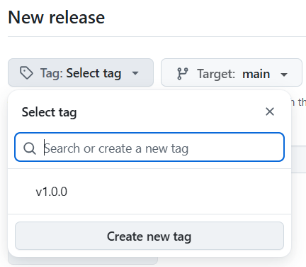

## ZENKAI Power!

This is the repository for the ZENKAI Power! project, including the source code, assets, and tools for building and releasing.

The following instructions are for buiding and releasing a new version.

### Setup

Requires `Docker`.

See [DOCKER.md](DOCKER.md) for image build and publishing instructions.

### Prepare

Set `version` in [game-info.json](game-info.json) without a `v` prefix. 

Use three version numbers: `major.minor.patch` (for example, `1.2.3`).

- **Patch releases:** bug fixes, performance improvements, translation updates, and small refinements to existing features.
- **Minor releases:** new features or substantial changes to existing behavior. Increment the middle number and reset the last number to zero.
- **Major releases (first number):** major milestones or changes that break compatibility.

Confirm `source` points to this project's GitHub repository.

### Build 

Clear game build cache.
```powershell
& { docker volume ls -q --filter 'name=^zenkaipower-release-[0-9a-f]{12}$' | ForEach-Object { docker volume rm $_ }; docker run --rm --mount type=volume,source=zenkaipower-android-work,target=/work --entrypoint /bin/sh zenkaipower/zenkaipower:latest -c 'rm -rf -- /work/port/build/android /work/android/app/build/intermediates /work/android/app/build/generated /work/android/app/build/tmp /work/android/.gradle' }
```

Build game for all platforms. The build scripts currently require the local
`zenkaipower` alias; point it at the published image and disable local image rebuilding.
```powershell
docker tag zenkaipower/zenkaipower:latest zenkaipower:latest
if ($LASTEXITCODE -ne 0) { throw 'Docker image tagging failed.' }
$env:ZENKAIPOWER_SKIP_IMAGE_BUILD = '1'
$version = (Get-Content -Raw game-info.json | ConvertFrom-Json).version
$env:GITHUB_REPOSITORY = 'ZenkaiPower/ZenkaiPower-Project'
$env:ZENKAIPOWER_RELEASE_TAG = "v$version"
.\port\release\build.ps1 all -Release
.\port\release\build.ps1 android -Release
```

### Sign 

Add [online signature](server/data/game_data_signature.json) to the builds.
```powershell
& {
$version = (Get-Content -Raw game-info.json | ConvertFrom-Json).version
$policyOutput = & docker run --rm --platform linux/amd64 --entrypoint python3 `
  --mount "type=bind,source=${PWD},target=/work" -w /work zenkaipower/zenkaipower:latest `
  port/tools/make_online_signature.py --stdout `
  --build build/ZenkaiPower-Linux/ZenkaiPower `
  --build build/ZenkaiPower-Windows/ZenkaiPower.exe `
  --build "release/ZenkaiPower-v$version-android-arm64.apk"
if ($LASTEXITCODE -ne 0) { throw 'Signature generation failed; policy was not changed.' }
$policyJson = $policyOutput -join "`n"
$policy = $policyJson | ConvertFrom-Json -ErrorAction Stop
if ($policy.scheme -ne 'zenkaipower-binaries-v2' -or
    $null -eq $policy.signatures -or $policy.signatures -is [array]) {
  throw 'Invalid signature policy; policy was not changed.'
}
[System.IO.File]::WriteAllText(
  (Join-Path $PWD 'server/data/game_data_signature.json'),
  $policyJson + "`n", [System.Text.UTF8Encoding]::new($false))
}
```

### Deploy

Deploy changes to the matchmaking server.
```powershell
docker run --rm -it --platform linux/amd64 --entrypoint python3 `
  --mount "type=bind,source=${PWD},target=/work" -w /work zenkaipower/zenkaipower:latest `
  server/tools/deploy_portable.py
```

### Release

Create a new tag in GitHub with the same version as in `game-info.json`. The tag name must be prefixed with `v`.


Release title:

```
ZENKAI Power! <version with v>
```

Release description follows the format:

```
**ZENKAI Power!**
---
**Version: <version without v>**

⚠️ <Important 1 if any, e.g., "This release must be installed manually by replacing the existing installation files.">
⚠️ <Important 2 if any>

**Added** <if any>
- Item 1 <with subtitems need ":", with no subitems need ".">:
  <figure here if any>
  - Subitem 1.
    <figure here if any>
  - Subitem 2.
    <figure here if any>
- Item 2:
  - Subitem 1.
  - Subitem 2.
- Item 3.

**Changed** <if any>
- Item 1
- Item 2
- Item 3

**Fixed** <if any>
- Item 1
- Item 2
- Item 3
```

### Bot

Compile the bot for all platforms.

```Powershell
docker run --rm --platform linux/amd64 --entrypoint /bin/sh -e ZENKAIPOWER_BOT_CREDENTIAL --mount "type=bind,source=${PWD},target=/src" -w /src zenkaipower/zenkaipower:latest port/bot/build.sh all
```

Generate a new bot credential. This will generate [bot.local.json](server/bot.local.json) with the new credential.

```powershell
docker run --rm --entrypoint python3 -e ZENKAIPOWER_BOT_CREDENTIAL `
  --mount "type=bind,source=${PWD},target=/work" -w /work zenkaipower/zenkaipower:latest `
  server/tools/bot_config.py --username SparkingBot
```

Deploy the bot to the server.

```powershell
docker run --rm -it --platform linux/amd64 --entrypoint python3 `
  --mount "type=bind,source=${PWD},target=/work" -w /work zenkaipower/zenkaipower:latest `
  server/tools/deploy_portable.py
```

Copy the [bot.local.json](server/bot.local.json) to the same directory as the bot executable. The bot will read the credential from this file.

### Server Credentials ⚠️

Server credentials are stored in `server/cloudflare.local.json`. This file is not included in the repository for security reasons. To deploy the server, you must create this file with the following structure:

```json
{
  "account_id": <account_id>,
  "api_token": <api_token>,
  "database_id": <database_id>
}
```

### Factory Reset Server ⚠️

```Powershell
docker run --rm -it --platform linux/amd64 --entrypoint python3 `
  --mount "type=bind,source=${PWD},target=/work" -w /work zenkaipower/zenkaipower:latest `
  server/tools/clear_d1.py
```

### Preview the website 

```Powershell
docker ps -q --filter "ancestor=zenkaipower/zenkaipower:latest" --filter "publish=4000" | ForEach-Object { docker stop $_ }; docker ps -q --filter "name=^/zenkaipower-pages-preview$" | ForEach-Object { docker stop $_ }; docker run --rm --name zenkaipower-pages-preview --platform linux/amd64 -p 4000:4000 -v "${PWD}:/work" --entrypoint python3 zenkaipower/zenkaipower:latest -u web/preview.py
```

Stop preview.
````powershell
docker ps -q --filter "name=^/zenkaipower-pages-preview$" | ForEach-Object { docker stop $_ }; docker ps -q --filter "ancestor=zenkaipower/zenkaipower:latest" --filter "publish=4000" | ForEach-Object { docker stop $_ }
````
