<!-- readme-only:start -->
 **Open the [ZENKAI Power! project page](https://zenkaipower.github.io/ZenkaiPower-Project/) for a better viewing experience of this README!**
<!-- readme-only:end -->

# Dragon Ball Z - Sparking! METEOR / Budokai Tenkaichi 3

The **ZENKAI Power!** project aims to provide a complete version of **Dragon Ball Z Sparking! METEOR**, also known as **Dragon Ball Z Budokai Tenkaichi 3**, as if the game had been officially released for PC and mobile. The project also celebrates the different releases of the game by bringing together their unique features into a definitive edition.

## Game Editions

Three localized versions of the game were released on two different consoles between late 2007 and early 2008.

### Sparking! METEOR

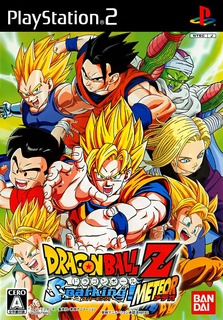

Originally released on October 4, 2007, for the PlayStation 2 and Nintendo Wii. It includes several textures that were changed in the Western releases. Its main distinction is a soundtrack featuring original music from the anime, with four more tracks than the Western versions.

### Budokai Tenkaichi 3

  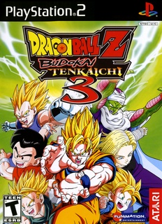
  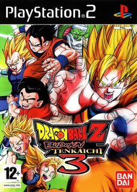

The Western version was released in Europe as PAL and in North America as NTSC. In addition to its different title, this version includes a unique 20-track soundtrack composed specifically for the game, along with an English voice option. Besides the 50 Hz versus 60 Hz refresh rates, the main differences are that the European version includes four additional text languages alongside English: German, Spanish, French, and Italian.

### Nintendo Wii Versions

  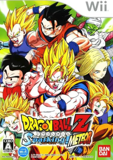
  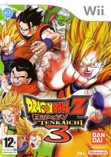

Both **Sparking! METEOR** and **Budokai Tenkaichi 3** (in both Western versions) were also released for the Wii, bringing the total to six official releases. The main addition was Dragon Net Battle, an exclusive game mode unavailable on the PlayStation 2. It allowed players to connect to the *Nintendo Wi-Fi Connection* (WFC) for online battles with friends, including ranked matches.

 The **ZENKAI Power!** project brings the best of these versions together into a single, definitive edition of the game.

## Decompilation Project

This project is only possible thanks to the reverse engineering work of [**Tenkaichi3Decomp**](https://github.com/z3xox/Tenkaichi3Decomp), which reconstructed the original game's source code, making it possible to modify the game and add new features. Many thanks to the project's author and all its contributors.

Some of the new features implemented by **Tenkaichi3Decomp** and inherited by **ZENKAI Power!** are listed below.

### Multi-Language and Translations

Support for multiple languages, including the official translations from the European version.

Fan translations can also be added to the game, although they are not included in the installation package.

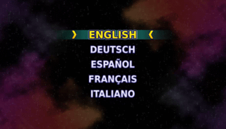

### Alternative Clash Controls

An optional control mode for *clashes* replaces analog stick rotation with repeated presses of the attack button. The alternative input is now shown in the bottom-left corner of the screen.

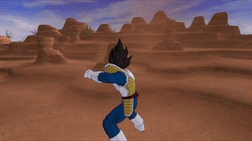

### Disc Fusion

The *Disc Fusion* game modes can be unlocked and played.

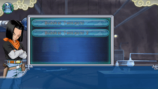

### Autosave

  With Autosave enabled, the game saves your progress automatically. The icon shown here appears while saving.
  

### Higher 3D Resolutions

3D battles can now be played at resolutions higher than 640×480.

### Texture Replacement

Higher-resolution texture packs can be added to the game.

### Video Options

New video options include *V-Sync*, *Frame Skipping*, and *Frame Interpolation*. These allow the game to run at frame rates above the NTSC version's original 30 FPS.

### Online Multiplayer

The connection method used to connect two players online was adapted from **Tenkaichi3Decomp**.

### Native Text

Menu text previously displayed as texture images has been replaced with native text.

### Auto-Skip Intro

In-game options to skip the opening movie and/or logos and copyright screens on startup.

## Added Features

**ZENKAI Power!** also introduces new features to provide an authentic experience.

### Widescreen Support

Both battles and menus now support widescreen displays, going beyond the original releases' 4:3 aspect ratio.

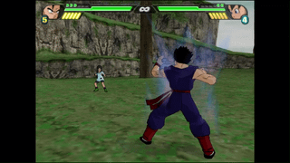

Each menu was carefully adapted by hand for widescreen support, using a different approach from **Tenkaichi3Decomp**. Battles use the same approach as **Tenkaichi3Decomp**.

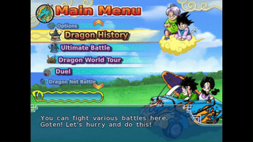

### Keyboard and Mouse Support

Keyboard and mouse support allows the game to be played without a controller. The mouse can also be used to navigate menus.

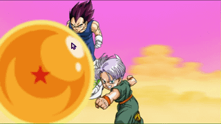

### New Options in the Options Menu

New options have been added directly to the game's Options Menu, providing more ways to configure the game.

### Game Edition Selection

You can switch between **Sparking! METEOR** and **Budokai Tenkaichi 3**, including each version's exclusive soundtrack and textures.

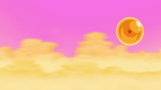

### Unlockable BGM

Like the original release, toggling to the Sparking! METEOR edition change the game's soundtrack to the anime's original music and allows the five unlockable BGM tracks to be available by completing specific requirements.

### Minor Modifications

*Dragon History* episode conclusion badge (the circle with a star) now varies based on the highest difficulty level used to complete the episode. The star appears in three different sizes depending on the difficulty level (Easy, Normal, Hard).

Leaving *Ultimate Battle* or *Ultimate Training* after progress was made will now prompt the player to save their progress on exit.

The *Character Reference* menu now include both Japanese and US voice actors credits for each character.

A filter was added to stop displaying ®, ™, and © symbols.

## Dragon Net Battle

*Dragon Net Battle* has been adapted to work over LAN or online. The connection method between two players was adapted from **Tenkaichi3Decomp**.

For LAN play, both players only need to set a player name and connect to the same local network. Casual game modes are available over LAN.

Online play allows players to connect over the internet for casual or ranked matches. Players must create a username and receive a user code for their account.

⚠️ Keep your username and user code somewhere safe, as both are required to log in to online mode. Do not share your user code or `savegame/net_account.dat` file.

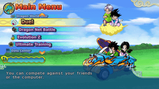

Online mode includes:

- Casual battles
  - 1 vs 1
  - Team Battle
  - 10 DP Team Battle
  - 15 DP Team Battle
  - 20 DP Team Battle
- Ranked battles
  - 1 vs 1
- Global player rankings

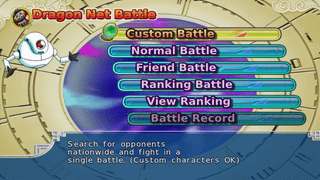

Ranked mode uses the game's native scoring system.

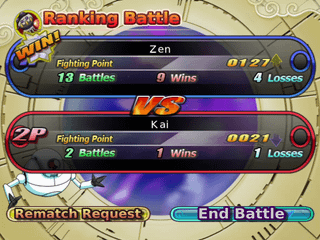

## Mobile Version

**ZENKAI Power!** is available for Android.
A similar project is the **[Tenkaichi3DecompAndroid](https://github.com/dfdx047/Tenkaichi3DecompAndroid)**.

⚠️ It currently requires a device running **Android 10 or later**, an **ARM64 CPU**, and support for **Vulkan**.

### Touchscreen Menus

The game's menus have been adapted for touchscreen devices, similar to the Mouse support on PC.

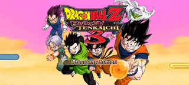

### Virtual Gamepad

During battles, a virtual gamepad can be displayed on the screen, allowing players to control the game without a physical controller.

The virtual gamepad uses original game artwork for the buttons.

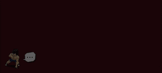

### Gamepad Support

Gamepad support is available for Android devices, allowing players to use a controller instead of the touchscreen.

## Sparking! Changes

The features above bring the original game to modern platforms, with native controls for menus and battles and content from its different editions brought together in one definitive version. **Classic Mode** preserves this experience, retaining the original gameplay and progression.

**Sparking! Changes** goes a step further, introducing small additions and refinements to the classic game while staying true to the spirit of the *Sparking! / Budokai Tenkaichi* franchise. These changes are optional and enabled by default. To disable them, turn **Classic Mode** on under **Options > More Options > General Settings** at the start of a new save. This choice is permanent for that save and disables all the features below.

### Training Settings

Add a pause menu to the training mode, allowing players to adjust training settings like health, ki and blast stock auto regeneration.

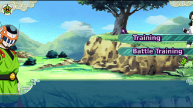

### Starting Characters and Stages

Ready to play *Dragon History* one more time?

Inspired by other Dragon Ball games that start with a limited roster and require players to unlock the remaining characters, **ZENKAI Power!** introduces a similar progression. Instead of starting with 132 characters unlocked, you begin with just 10. The rest of those 132 characters can be unlocked through Dragon History. The remaining characters in the game's full roster of 161 are unlocked as usual, just as in the original releases.

Stages follow a similar progression: you begin with 15 stage entries unlocked instead of the original 27. The other 12 starting entries now unlock by completing specific Dragon History episodes. The remaining 8 entries in the full selection of 35 retain their original unlock requirements.

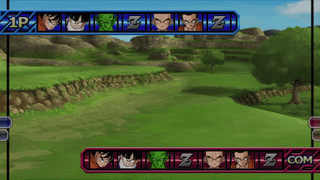

### Difficulty

Game modes raises base CPU difficulty, making the game a little more challenging. Duel retains the original five levels. Max CPU level stays the same and no CPU level or behavior was changed or added to the game.

### Story Restrictions

In the first episode of *Dragon History*, Goku (Early) Kaioken Attack, Genki Dama and Kaioken ability was disabled, to be accurate with the history. It also disables Goku (Early) special Kienzan blast on Saiyan Saga, for the same reason.

### *Dragon World Tour*

Tournament opponents now follow *Dragon History* progression. The CPU roster includes characters you have unlocked, plus the character rewards from every available saga. Brackets favor different characters before adding alternate incarnations or transformations. *World Martial Arts Big Tournament*, *Cell Games*, and *Otherworld Tournament* become available after clearing the *Android Saga*.

CPU-only matches are resolved using DP-weighted odds, giving stronger characters a greater chance of advancing, not the original 50/50 change. *Yamcha Game* uses Desert stages that progress from noon to evening, then night for the final fight.

### Gameplay Changes

**Oozaru Transformations**

Personagens que sempre utilizavam Power Ball para se transformarem em Giant Ape, agora utilizam a lua cheia quando disponível.

**Perfect Cell's Transformation**

A transformação de Perfect Form Cell em Super Perfect Cell foi modificada, incluindo uma animação com Semi-Perfect Cell explodindo.

**Goku (End) Super Saiyan 2**

Goku Super Saiyajin 2 primeiro Blast 2 se torna Super Kamehameha, e seu Ultimate Blast se torna Instant Kamehameha.

**Tiered Kaioken**

Kaioken now has three tiers: Kaioken, Kaioken x3, and Kaioken x4. Activation selects the highest tier you can afford. Activating it again while it is active upgrades to a higher tier. Higher tiers increase the stat bonuses and HP drain.

**Ginyu's Body Change**

*Body Change* uses a revised selection of bodies: Goku (Mid), Kid Gohan, Krillin, and Vegeta (Scouter). Using Ginyu's self-injury power-up first enables an alternate selection of Super Saiyan Goku (Mid), Piccolo (Early), and Frieza Final Form.

## Installation

To install the game, you must own a copy of the North American NTSC PlayStation 2 version of **Dragon Ball Z Budokai Tenkaichi 3**. Other versions are optional to add extra content and unlock some of the features listed above, including *Dragon Net Battle*.

Check the [**releases page**](https://github.com/ZenkaiPower/ZenkaiPower-Project/releases/latest) for latest version and changelog.

  

    <h3>Desktop</h3>
    
Download <strong>Windows</strong> or <strong>Linux</strong> <code>.zip</code> files, extract them, and follow the installer's instructions.

    
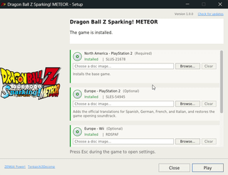

  

  

    <h3>Android</h3>
    
Download the <strong>Android</strong> <code>.apk</code> file, install it on your Android device, and follow the instructions in the app.

    
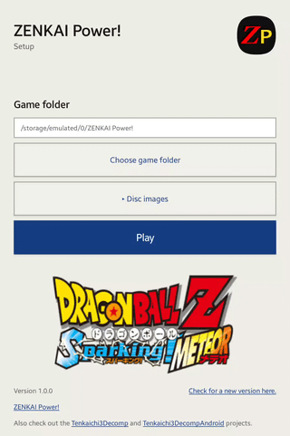

  

⚠️ No game files are distributed with the **ZENKAI Power!** project. The logos shown above on the setups is extracted from the original game discs.

### Game Versions Discs Supported

- **North America - PlayStation 2** (**Required** `SLUS-21678`): Installs the base game.
- **Europe - PlayStation 2** (Optional `SLES-54945`): Adds the official Spanish, German, French, and Italian translations and restores the game opening soundtrack.
- **Europe - Wii** (Optional `RDSPAF`): Adds the Dragon Net Battle mode, exclusive to the Wii version. Required for playing LAN or online.
- **Japan - PlayStation 2** (Optional `SLPS-25815`): Adds the option to toggle exclusive content from the Japanese version, Sparking! METEOR, including title screen artwork, anime soundtrack, and more.

## Licenses

**Tenkaichi3Decomp** is licensed under the [GNU Affero General Public License v3.0](https://github.com/z3xox/Tenkaichi3Decomp/blob/main/LICENSE). The **ZENKAI Power!** project follows the same licensing model and is licensed under the [GNU Affero General Public License v3.0](./LICENSE).

This means that the source code of both **Tenkaichi3Decomp** and **ZENKAI Power!** is freely available for anyone to use, modify, and redistribute, provided that any distributed modified versions remain ***open-source under the same license***.

Licenses for third-party components used in **ZENKAI Power!** can be found in the `licenses` folder of the game's installation package.

## Legal

**ZENKAI Power!** is an unofficial fan modification of **Dragon Ball Z: Sparking! METEOR** and **Dragon Ball Z: Budokai Tenkaichi 3**. It is not affiliated with, sponsored by, or endorsed by Bandai Namco Entertainment, Bird Studio, Shueisha, Toei Animation, or any other rights holder. The project's open-source licenses do not grant rights to the original games content. This project is intended for educational and personal entertainment purposes. Users must supply their own legally obtained game discs. This project does not distribute disc images or original game content.
