# Dragon History progression and Special Saga unlock map

This maps the current episode-unlock rewards, with Special Saga grouped by the main saga that opens each branch. It describes unlock dependencies, not the chronological placement of the movies. No gameplay changes are proposed or applied here.

## How progression works

To create a separate development save with all 48 episodes available, run:

```powershell
python port/tools/generate_dragon_history_save.py
```

The output is `port/build/generated-saves/dragon-history/zenkaipower.sav`.
Use `--output PATH` to choose a destination; an existing file is replaced only
with `--force`. Close the game before installing it as the active Zenkai save.
Keep a backup of your existing save and its `.options` companion before installing
the generated save, and move the old companion aside so its settings do not carry over.

This creates a fresh save with the ten-character Zenkai starting roster, zero
Zeni, and the Zenkai pack enabled. All main, Special, and What If episodes are
unlocked and marked new, but none are cleared: rewards, completion records,
difficulty badges, and Cell-completion tournament gates are not granted.
Optionally pass `--common-file4 PATH` with unpacked common file 4 to include the
normal starter items; otherwise no starter items are granted. No game assets
are needed to generate the save. The native and v3 envelope checksums are rebuilt.

Regression check: `python port/tests/save/dragon_history_generator.py`.

For a separate save with all **161 characters**, all **35 stage entries**,
all **48 Dragon History episodes**, all **100 missions**, **Survival**, and
maximum shop stock available, run:

```powershell
python port/tools/generate_all_content_save.py
```

Output: `port/build/generated-saves/all-content/zenkaipower.sav`.
Episodes and missions remain uncleared, Survival records remain empty, and shop
items stay unowned so they can be bought. Zeni starts at zero and the Zenkai pack
stays enabled. This unlocks stock sold by the shop; reward-only/hidden items do
not become shop merchandise. The same `--output`, `--force`, `--common-file4`
and installation guidance above apply.

Regression check: `python port/tests/save/all_content_generator.py`.


- A new game starts with **Saiyan 1: Common Enemy** available.
- Winning an episode grants its episode-unlock rewards. Opening an episode is enough to list its saga; completing an entire saga is not a separate prerequisite.
- The main route is a single chain: **Saiyan -> Frieza -> Android / Cell -> Majin Buu -> Dragon Ball GT -> Dragon Ball -> What If**.
- Special Saga is a set of optional branches attached to that main route. Its 16 episodes do **not** form one continuous chain.
- Every Special episode has one direct unlocking episode. Some are unlocked by another Special episode, but each branch ultimately comes from Saiyan, Frieza, Android / Cell, or Majin Buu.
- Special Saga completion is not required to continue the main route. Unlocking the last main-route episode therefore does not imply that all Special follow-ups have been unlocked.
- These unlock edges come from the original story scripts. Zenkai adds character rewards but does not replace the episode-unlock list.

## Zenkai stage rewards

These stage unlocks belong to `dragon_history_unlocking` and follow its build flag
`PORT_ZENKAI_STORY_UNLOCKS`. They require the Zenkai pack to be enabled (Classic
Mode off). Win the named episode to unlock every listed variation, with a normal
stage reward popup for each newly unlocked entry.

| Saga | Episode to win | Stage and included variations | Stage IDs |
|---|---|---|---|
| Saiyan | 3: Ultimate Decisive Battle | Namek / Planet Namek | 2 |
| Frieza | 4: Legendary Super Saiyan | Destroyed Namek / Dying Namek | 3 |
| Android / Cell | 1: Enraged Android | Mountain Road: Noon and Evening | 10, 33 |
| Android / Cell | 2: Vegeta's Curiosity | Islands | 11 |
| Android / Cell | 3: Perfect Body | Cell Games: Evening and Noon | 6, 28 |
| Special | 1: Alone for the Final Battle | Space / Outer Space | 16 |
| Special | 2: Strongest in the World | Glacier | 14 |
| Majin Buu | 4: Battle for the Universe | Supreme Kai World / Supreme Kai's World | 7 |
| What If | 3: Galaxy Battle | Planet: Night and Evening | 13, 34 |

The Frieza episode named Legendary Super Saiyan grants Dying Namek; Special
Saga's episode with the same name does not. Special episode numbers above use
visible menu positions, not rotated internal script IDs.

New Zenkai saves start with these twelve stage entries locked. Merely making an
episode available does not unlock its stages, including in the all-episodes
development save. Existing stage unlocks are retained; replaying a completed
episode grants any missing reward without duplicate popups. Original stage
rewards from other episodes/modes remain intact. No stage has additional base-game
variations beyond those listed here.

Classic Mode restores the original starting-stage availability without removing
extra unlocks. Original mode and builds with story unlocking disabled keep their
original stage defaults and rewards. Implementation: `port_story_stage_unlocks.h`,
`Save_SetDefaults`, and `HistResult_BuildRewards`. The build-flag regression test
checks all 48 visible episode positions, variants, replays, defaults and Classic Mode.

## Special Saga, grouped by its originating saga

**Special #** below is the episode position in the visible Special Saga menu. A follow-up requires winning the preceding Special episode; it is not granted immediately by the main-saga victory.

| Originating saga | Special episodes in its branches | Count |
|---|---|---:|
| Saiyan | #2, #3 | 2 |
| Frieza | #1, #4, #5, #6 | 4 |
| Android / Cell | #7, #8, #9, #10, #11, #12 | 6 |
| Majin Buu | #13, #14, #15, #16 | 4 |

### From Saiyan Saga

| Main episode to win | Special episode unlocked | Follow-up unlocked by winning that Special episode |
|---|---|---|
| **3. Ultimate Decisive Battle** | **#2: Strongest in the World** | **#3: Final Battle For Earth** |

### From Frieza Saga

| Main episode to win | Special episode unlocked | Follow-up unlocked by winning that Special episode |
|---|---|---|
| **1. Super Saiyan?!** | **#1: Alone for the Final Battle** | None |
| **2. Frieza's Ultimate Transformation!** | **#4: Super Saiyan Goku** | None |
| **4. Legendary Super Saiyan** | **#5: Destroy the Makyo Star** | **#6: Strongest Vs. Strongest** |

### From Android / Cell Saga

| Main episode to win | Special episode unlocked | Follow-up unlocked by winning that Special episode |
|---|---|---|
| **1. Enraged Android** | **#7: Clash of the Ultimate Warriors** | None |
| **2. Vegeta's Curiosity** | **#8: Ultimate Battle! Three Super Saiyans** | None |
| **3. Perfect Body** | **#9: Legendary Super Saiyan** | **#10: Blaze! Ultimate Burning Battle** |
| **6. Final Battle** | **#11: Galactic Crisis** | **#12: I Will Protect the Earth!** |

### From Majin Buu Saga

| Main episode to win | Special episode unlocked | Follow-up unlocked by winning that Special episode |
|---|---|---|
| **1. Destined Battle: Goku Vs. Vegeta** | **#13: Dangerous Duo! The Ultimate Warrior Doesn't Sleep** | None |
| **2. Farewell to the Proud Warrior** | **#14: Innocent Monster** | **#15: Fusion Reborn! Goku and Vegeta** |
| **5. Conclusion** | **#16: Dragon Fist Explosion! If Goku Doesn't, Who Will?** | None |

## Branch overview

Each arrow means: **win the source episode to unlock the target**. The two episodes named Legendary Super Saiyan belong to different sagas.

```mermaid
flowchart TD
    S3["Saiyan 3: Ultimate Decisive Battle"] --> SP2["Special 2: Strongest in the World"]
    SP2 --> SP3["Special 3: Final Battle For Earth"]
    F1["Frieza 1: Super Saiyan?!"] --> SP1["Special 1: Alone for the Final Battle"]
    F2["Frieza 2: Frieza's Ultimate Transformation!"] --> SP4["Special 4: Super Saiyan Goku"]
    F4["Frieza 4: Legendary Super Saiyan"] --> SP5["Special 5: Destroy the Makyo Star"]
    SP5 --> SP6["Special 6: Strongest Vs. Strongest"]
    A1["Android 1: Enraged Android"] --> SP7["Special 7: Clash of the Ultimate Warriors"]
    A2["Android 2: Vegeta's Curiosity"] --> SP8["Special 8: Ultimate Battle! Three Super Saiyans"]
    A3["Android 3: Perfect Body"] --> SP9["Special 9: Legendary Super Saiyan"]
    SP9 --> SP10["Special 10: Blaze! Ultimate Burning Battle"]
    A6["Android 6: Final Battle"] --> SP11["Special 11: Galactic Crisis"]
    SP11 --> SP12["Special 12: I Will Protect the Earth!"]
    B1["Buu 1: Destined Battle: Goku Vs. Vegeta"] --> SP13["Special 13: Dangerous Duo!"]
    B2["Buu 2: Farewell to the Proud Warrior"] --> SP14["Special 14: Innocent Monster"]
    SP14 --> SP15["Special 15: Fusion Reborn! Goku and Vegeta"]
    B5["Buu 5: Conclusion"] --> SP16["Special 16: Dragon Fist Explosion!"]
```



## Full main-route progression

Read top to bottom. Each main-route episode unlocks the next row, including across saga boundaries. The final episode has no successor. Special unlocks are additional rewards, not replacements for the main-route successor.

| Saga | Episode | Title | Additional Special unlock |
|---|---:|---|---|
| Saiyan | 1 | Common Enemy | - |
| Saiyan | 2 | Goku's Quiet Rage | - |
| Saiyan | 3 | Ultimate Decisive Battle | #2: Strongest in the World |
| Frieza | 1 | Super Saiyan?! | #1: Alone for the Final Battle |
| Frieza | 2 | Frieza's Ultimate Transformation! | #4: Super Saiyan Goku |
| Frieza | 3 | Defeat Frieza! | - |
| Frieza | 4 | Legendary Super Saiyan | #5: Destroy the Makyo Star |
| Android / Cell | 1 | Enraged Android | #7: Clash of the Ultimate Warriors |
| Android / Cell | 2 | Vegeta's Curiosity | #8: Ultimate Battle! Three Super Saiyans |
| Android / Cell | 3 | Perfect Body | #9: Legendary Super Saiyan |
| Android / Cell | 4 | Cell Games Begin | - |
| Android / Cell | 5 | Gohan Explodes! | - |
| Android / Cell | 6 | Final Battle | #11: Galactic Crisis |
| Android / Cell | 7 | Future Peace | - |
| Majin Buu | 1 | Destined Battle: Goku Vs. Vegeta | #13: Dangerous Duo! The Ultimate Warrior Doesn't Sleep |
| Majin Buu | 2 | Farewell to the Proud Warrior | #14: Innocent Monster |
| Majin Buu | 3 | Final Fusion | - |
| Majin Buu | 4 | Battle for the Universe | - |
| Majin Buu | 5 | Conclusion | #16: Dragon Fist Explosion! If Goku Doesn't, Who Will? |
| Dragon Ball GT | 1 | Immortal Monster | - |
| Dragon Ball GT | 2 | Ultimate Android | - |
| Dragon Ball GT | 3 | Solar Warrior 6000 Degrees of Power! | - |
| Dragon Ball GT | 4 | Ultimate Super Gogeta | - |
| Dragon Ball GT | 5 | A Miracle Saves The Day! | - |
| Dragon Ball | 1 | Ceiling Vs. Ground | - |
| Dragon Ball | 2 | Battle in Korin Tower | - |
| Dragon Ball | 3 | Goku Strikes Back | - |
| Dragon Ball | 4 | Penguin Village | - |
| What If | 1 | Dream Match: Goku Vs. Arale | - |
| What If | 2 | Affectionate Android | - |
| What If | 3 | Galaxy Battle | - |
| What If | 4 | Unexpected Help | - |

## Direct prerequisites for every Special episode

This table is in visible Special Saga menu order, which is different from unlock order.

| Special # | Episode | Win this episode first | Script / reward ID |
|---:|---|---|---:|
| 1 | Alone for the Final Battle | Frieza 1: Super Saiyan?! | 19 |
| 2 | Strongest in the World | Saiyan 3: Ultimate Decisive Battle | 21 |
| 3 | Final Battle For Earth | Special 2: Strongest in the World | 22 |
| 4 | Super Saiyan Goku | Frieza 2: Frieza's Ultimate Transformation! | 23 |
| 5 | Destroy the Makyo Star | Frieza 4: Legendary Super Saiyan | 20 |
| 6 | Strongest Vs. Strongest | Special 5: Destroy the Makyo Star | 24 |
| 7 | Clash of the Ultimate Warriors | Android / Cell 1: Enraged Android | 25 |
| 8 | Ultimate Battle! Three Super Saiyans | Android / Cell 2: Vegeta's Curiosity | 26 |
| 9 | Legendary Super Saiyan | Android / Cell 3: Perfect Body | 27 |
| 10 | Blaze! Ultimate Burning Battle | Special 9: Legendary Super Saiyan | 28 |
| 11 | Galactic Crisis | Android / Cell 6: Final Battle | 29 |
| 12 | I Will Protect the Earth! | Special 11: Galactic Crisis | 30 |
| 13 | Dangerous Duo! The Ultimate Warrior Doesn't Sleep | Majin Buu 1: Destined Battle: Goku Vs. Vegeta | 31 |
| 14 | Innocent Monster | Majin Buu 2: Farewell to the Proud Warrior | 32 |
| 15 | Fusion Reborn! Goku and Vegeta | Special 14: Innocent Monster | 33 |
| 16 | Dragon Fist Explosion! If Goku Doesn't, Who Will? | Majin Buu 5: Conclusion | 34 |

## Character unlock groups: main saga plus its Special branches

These are the character rewards available in **Zenkai mode** when the main saga and all Special branches originating from it are completed. Follow-up Special episodes inherit the originating main saga shown above. Dragon Ball GT, Dragon Ball, and What If have no Special branches.

Counts use **roster entries**: transformations count separately. Lists combine the original script rewards with Zenkai additions, remove duplicates within each group, and exclude the ten starting entries. They describe rewards earned by clearing these episodes, not every character that could be obtained through other modes.

### Starting roster

Goku (Early); Kid Gohan; Piccolo (Early); Krillin; Yamcha; Tien; Chiaotzu; Yajirobe; Master Roshi; Master Roshi Full Power.

**10 starting entries**, representing nine base characters plus Master Roshi's Full Power form. These are available before any saga is cleared.

### Group totals

The cumulative column assumes every earlier group and all its assigned Special branches have also been completed. It includes the starting roster; it is not a minimum roster required to enter the saga.

| Main saga | Main-saga rewards | Assigned Special rewards | Combined unique entries | Cumulative available entries |
|---|---:|---:|---:|---:|
| Saiyan | 7 | 3 | **10** | 20 |
| Frieza | 16 | 12 | **28** | 48 |
| Android / Cell | 36 | 9 | **45** | 93 |
| Majin Buu | 22 | 7 | **29** | 122 |
| Dragon Ball GT | 17 | 0 | **17** | 139 |
| Dragon Ball | 8 | 0 | **8** | 147 |
| What If | 5 | 0 | **5** | 152 |

### Saiyan: 10 combined entries

**Main saga:** Vegeta (Scouter); Great Ape Vegeta; Raditz; Great Ape Raditz; Saibamen; Nappa; Great Ape Nappa.

**Assigned Special branches:** Dr. Wheelo; Turles; Great Ape Turles.

### Frieza: 28 combined entries

**Main saga:** Goku (Mid); Goku (Mid) Super Saiyan; Nail; Zarbon; Zarbon Post-Transformation; Dodoria; Captain Ginyu; Recoome; Burter; Jeice; Guldo; Frieza 1st Form; Frieza 2nd Form; Frieza 3rd Form; Frieza (Final Form); Frieza (100% Power).

**Assigned Special branches:** Bardock; Great Ape Bardock; Cui; Appule; Frieza Soldier; Garlic Jr.; Super Garlic Jr.; Slug; Giant Slug; Salza; Cooler; Cooler (Final Form).

### Android / Cell: 45 combined entries

**Main saga:** Goku (End); Goku (End) Super Saiyan; Teen Gohan; Teen Gohan Super Saiyan; Teen Gohan Super Saiyan 2; Gohan (Adult); Gohan (Adult) Super Saiyan; Great Saiyaman; Piccolo (End); Vegeta; Vegeta Super Saiyan; Super Vegeta; Vegeta (End); Vegeta (End) Super Saiyan; Trunks (Sword); Trunks (Sword) Super Saiyan; Trunks; Trunks Super Saiyan; Super Trunks; Kid Trunks; Kid Trunks Super Saiyan; Goten; Goten Super Saiyan; Mr. Satan (Hercule); Videl; Mecha Frieza; Android #16; Android #17; Android #18; Android #19; Dr. Gero (Android 20); Cell (1st Form); Cell (2nd Form); Perfect Cell; Super Perfect Cell; Cell Jr.

**Assigned Special branches:** Pikkon; Metal Cooler; Android 13; Fusion Android 13; Broly; Broly Super Saiyan; Zangya; Bojack; Full Power Bojack.

### Majin Buu: 29 combined entries

**Main saga:** Goku (End) Super Saiyan 2; Goku (End) Super Saiyan 3; Gohan (Adult) Super Saiyan 2; Ultimate Gohan; Vegeta (End) Super Saiyan 2; Majin Vegeta; Gotenks; Gotenks Super Saiyan; Gotenks Super Saiyan 3; Vegito; Super Vegito; Supreme Kai; Kibito Kai; Babidi; Dabura; Majin Buu; Evil Buu; Super Buu; Super Buu (Gotenks Absorbed); Super Buu (Gohan Absorbed); Kid Buu; Spopovich.

**Assigned Special branches:** Super Gogeta; Great Saiyaman 2; Tapion; Broly Legendary Super Saiyan; Janemba; Super Janemba; Hirudegarn.

### Dragon Ball GT: 17 combined entries

**Main saga:** Goku (GT); Goku (GT) Super Saiyan; Goku (GT) Super Saiyan 3; Goku (GT) Super Saiyan 4; Vegeta Super Saiyan 4; Gogeta Super Saiyan 4; Pan; Uub; Majuub; Baby Vegeta; Super Baby 1; Super Baby 2; Great Ape Baby; Super 17; Nuova Shenron; Syn Shenron; Omega Shenron.

**Assigned Special branches:** None.

### Dragon Ball: 8 combined entries

**Main saga:** Kid Goku; Kid Goku Great Ape; Grandpa Gohan; Nam; Tao Pai Pai; General Blue; Demon King Piccolo; Tambourine.

**Assigned Special branches:** None.

### What If: 5 combined entries

**Main saga:** Android #8; King Vegeta; Great Ape King Vegeta; Devilman; Arale.

**Assigned Special branches:** None.

### Scope and reward details

- The group is based on the saga that unlocks the Special branch, not the saga in which a character appears in the story. For example, Bardock belongs to the Frieza unlock group here, and Turles belongs to Saiyan.
- Original rewards are included: for example, Dr. Wheelo in the Saiyan-assigned Special branch, Babidi in Majin Buu, Nuova Shenron in GT, and Nam in Dragon Ball.
- Frieza's Super Saiyan?! normally substitutes the Frieza-force group for Nail; Nail moves to Frieza's Ultimate Transformation! The existing all-unlocked fallback does not change the combined Frieza group.
- The What If group is **Arale, Android 8, King Vegeta, Great Ape King Vegeta, and Devilman**. Unexpected Help grants Devilman; King Cold is not that episode's reward.
- Completing all mapped episodes yields 142 distinct reward entries, or **152 entries including the starting roster**. Entries outside these groups are: Fasha; Great Ape Fasha; King Cold; Cyborg Tao; Pilaf Machine; Pilaf Machine Fusion; Chi-Chi; Future Gohan; Future Gohan Super Saiyan. Their unlock conditions in other modes are outside this map.
- Verification: each episode's decoded original rewards was passed through the current `HistResult_BuildRewards` with an empty synthetic save and Zenkai enabled. The resulting character-bit sets were grouped using the unlock graph. Names and forms were checked against Character Reference text (file `0x1D0`, section 1, unpacked sections 22 and 23). This checks reward code/data, not an in-game playthrough.

## Verification and implementation references

The map was decoded from the local US game archive at `build/ZenkaiPower-Windows/gamedata/pzs3us1.afs`, using the repository's existing script decoder. All 48 scripts contain one 15-value reward command; its final three values supply the episode unlock IDs. The resulting graph has 48 episodes and 47 edges, reaches every episode from Common Enemy, and gives each non-starting episode exactly one direct prerequisite. This is a static data/source verification, not a completed in-game playthrough.

- Episode titles: menu archive file `0x1C7`, section 42, nested text section 11; whitespace normalized.
- Script files: `0x1FF + script ID`; decoded by [story_routes.py](../../port/tools/story_routes.py).
- Reward command: [BtlScriptCmd_SetRewards](../../src/battle/btl_script_cmd.c) reads command 16 into the story reward block.
- Applying rewards: [HistResult_BuildRewards](../../src/menu/menu_c_c.c) lists sagas and unlocks the rewarded episodes after a victory.
- New-game starting availability: [Save_SetDefaults](../../src/sys/save.c).
- Menu-to-script numbering: [ModeMenu_GetLine](../../src/menu/menu_a_d.c), reversed by `HistResult_SplitEpisode` in the result code.

**Numbering pitfall:** internal IDs 20-23 are rotated relative to visible Special Saga order. Special #2 uses script/reward ID 21, #3 uses 22, #4 uses 23, and #5 uses 20. Ignoring that rotation incorrectly assigns the Frieza unlocks to the wrong episodes.
